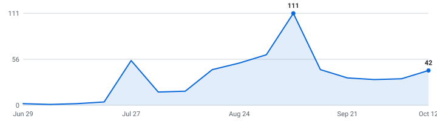

# Indian Tech Internships

   

A self-updating engine that tracks tech internships so you don't have to. Instead of refreshing a dozen career pages by hand, it reads company hiring feeds directly and keeps one live list, newest roles on top, refreshed automatically throughout the day.

**121 open roles · 32 new this week · 5,202 companies tracked · updated Oct 26, 2026 at 10:46 UTC**

**⭐Star this repo⭐** to save it and get updates when new roles are added.

**Live:** [dashboard](https://aditya-s45.github.io/placement-interns/) · [RSS feed](https://aditya-s45.github.io/placement-interns/feed.xml) (instant alerts in any RSS app) · [JSON API](https://aditya-s45.github.io/placement-interns/api/jobs.json)

**🔔 New roles in your inbox:** [subscribe by email](https://aditya-s45.github.io/placement-interns/#subscribe) - one email a day, only when new internships actually appeared, one-click unsubscribe. (Prefer RSS-to-email? [Feedrabbit works too](https://feedrabbit.com/subscriptions/new?url=https%3A%2F%2Fraw.githubusercontent.com%2Faditya-s45%2Fplacement-interns%2Fmain%2Fdocs%2Ffeed.xml).)
---

## Summer 2027  (61 open)

| Company | Role | Category | Pay & Specs | Location | Posted | Apply |
|---|---|---|---|---|---|---|
| Marvell | Software Intern ~ 🆕 | Software | — | Bangalore | Oct 26, 2026 | [Apply](https://marvell.wd1.myworkdayjobs.com/MarvellCareers2/job/Bangalore/Software-Intern_2604252) |
| Marvell | Intern, Software Engineer ~ 🆕 | Software | — | Hyderabad | Oct 26, 2026 | [Apply](https://marvell.wd1.myworkdayjobs.com/MarvellCareers2/job/Hyderabad/Intern--Software-Engineer_2603885) |
| Marvell | Software Engineer Intern ~ 🆕 | Software | — | Hyderabad | Oct 26, 2026 | [Apply](https://marvell.wd1.myworkdayjobs.com/MarvellCareers2/job/Hyderabad/Software-Engineer-Intern_2604237) |
| Illumina | Apprentice(Finance) ~ 🆕 | Other | — | India - Bengaluru - Manyata | Oct 25, 2026 | [Apply](https://illumina.wd1.myworkdayjobs.com/illumina-careers/job/India---Bengaluru---Manyata/Apprentice-Finance-_43668-JOB) |
| Honeywell | Intern Bachelors AI ~ 🆕 | Data & ML/AI | — | Bengaluru, Karnataka, India | Oct 24, 2026 | [Apply](https://ibqbjb.fa.ocs.oraclecloud.com/hcmUI/CandidateExperience/en/sites/CX_1/job/160494) |
| Honeywell | Intern Bachelors Software Eng ~ 🆕 | Software | — | Bengaluru, Karnataka, India | Oct 24, 2026 | [Apply](https://ibqbjb.fa.ocs.oraclecloud.com/hcmUI/CandidateExperience/en/sites/CX_1/job/160495) |
| Pearson | Apprentice, Portfolio Management ~ | Other | — | Bangalore, Karnataka, India | Oct 23, 2026 | [Apply](https://hccz.fa.em3.oraclecloud.com/hcmUI/CandidateExperience/en/sites/CX_2/job/26049) |
| Cushman & Wakefield | EIC Apprentice - Valuations and Advisory_Gurugram ~ | Other | — | Gurgaon, India | Oct 23, 2026 | [Apply](https://cw.wd1.myworkdayjobs.com/external/job/Gurgaon-India/EIC-Apprentice---Valuations-and-Advisory-Gurugram_R327452) |
| Marvell | Intern, Software Engineer - Bachelor's Degree ~ | Software | — | Hyderabad | Oct 23, 2026 | [Apply](https://marvell.wd1.myworkdayjobs.com/MarvellCareers2/job/Hyderabad/Intern--Software-Engineer---Bachelor-s-Degree_2604624) |
| Marvell | Intern, Software QA Engineer - Bachelor's Degree ~ | Software | — | Hyderabad | Oct 23, 2026 | [Apply](https://marvell.wd1.myworkdayjobs.com/MarvellCareers2/job/Hyderabad/Intern--Software-QA-Engineer---Bachelor-s-Degree_2604250) |
| Valeo | AI - Intern ~ | Data & ML/AI | — | Chennai | Oct 23, 2026 | [Apply](https://valeo.wd3.myworkdayjobs.com/valeo_jobs/job/Chennai/AI---Intern_REQ2026080851) |
| Coinbase | Software Engineer Intern ~ | Software | — | Hybrid - Singapore | Oct 21, 2026 | [Apply](https://www.coinbase.com/careers/positions/8175873?gh_jid=8175873) |
| Walrus | Full Stack Developer Intern ~ | Software | — | New York City (Hybrid) | Oct 21, 2026 | [Apply](https://jobs.ashbyhq.com/walrusfi/7dd09f17-cfff-48d8-8e4e-c3e016fe8cf5) |
| Dun & Bradstreet | Apprentice (R-20025) ~ | Other | — | Mumbai - India | Oct 21, 2026 | [Apply](https://jobs.lever.co/dnb/a61b6368-4c4f-4e1b-b125-d0d7ba7f8278) |
| Dun & Bradstreet | Apprentice (R-20077) ~ | Other | — | Mumbai - India | Oct 21, 2026 | [Apply](https://jobs.lever.co/dnb/fa0a5dc9-1217-4e73-978e-aa503a00ca4b) |
| Revvity | AI Applications DevOps Intern ~ | Data & ML/AI | — | Mumbai | Oct 21, 2026 | [Apply](https://revvity.wd103.myworkdayjobs.com/External/job/Mumbai/AI-Applications-DevOps-Intern_JR-045766) |
| Revvity | Full-Stack AI Engineering Intern ~ | Data & ML/AI | — | Mumbai | Oct 21, 2026 | [Apply](https://revvity.wd103.myworkdayjobs.com/External/job/Mumbai/Full-Stack-AI-Engineering-Intern_JR-045768) |
| Liberty University | ADS Apprentice ~ | Other | — | Hybrid | Oct 20, 2026 | [Apply](https://liberty.wd5.myworkdayjobs.com/lu_job_board_staff/job/Hybrid/ADS-Apprentice_R0010936-1) |
| Cushman & Wakefield | EIC Apprentice ~ | Other | — | Mumbai, India | Oct 16, 2026 | [Apply](https://cw.wd1.myworkdayjobs.com/external/job/Mumbai-India/EIC-Apprentice_R-INDINT-039) |
| Innovaccer | Apprentice - Total Rewards ~ | Other | — | Noida, Uttar Pradesh, India | Oct 15, 2026 | [Apply](https://apply.workable.com/innovaccer-analytics/j/536764D921/) |
| Carousell Group | Android Engineer Intern - 6 months ~ | Software | — | Bengaluru, KA, India | Oct 14, 2026 | [Apply](https://jobs.smartrecruiters.com/carousellgroup/744000155411579) |
| Rolls-Royce | Integrated Control Systems Engineer Intern (Software) ~ | Software | — | Indianapolis | Oct 13, 2026 | [Apply](https://rollsroyce.wd3.myworkdayjobs.com/Intern_Graduate/job/Indianapolis/Integrated-Control-Systems-Engineer-Intern--Software-_JR6161452) |
| Cushman & Wakefield | EIC Apprentice - Project Development Services, Gurgaon ~ | Other | — | Gurgaon, India | Oct 13, 2026 | [Apply](https://cw.wd1.myworkdayjobs.com/external/job/Gurgaon-India/EIC-Apprentice---Project-Development-Services--Gurgaon_R340103) |
| Cushman & Wakefield | EIC Apprentice - Project Development Services, Mumbai ~ | Other | — | Mumbai, India | Oct 13, 2026 | [Apply](https://cw.wd1.myworkdayjobs.com/external/job/Mumbai-India/EIC-Apprentice---Project-Development-Services--Mumbai_R340094) |
| Cushman & Wakefield | EIC Apprentice - Valuations (Mumbai) ~ | Other | — | Mumbai, India | Oct 13, 2026 | [Apply](https://cw.wd1.myworkdayjobs.com/external/job/Mumbai-India/EIC-Apprentice---Valuations--Mumbai-_R340091) |
| Coinbase | Forward Deployed Engineer Intern (HR Technology) ~ | Software | — | Hybrid - New York, NY | Oct 09, 2026 | [Apply](https://www.coinbase.com/careers/positions/8175510?gh_jid=8175510) |
| Allison Transmission | IT Security Analyst Internship - Summer 2027 | Other | — | Indianapolis, IN | Oct 09, 2026 | [Apply](https://allisontransmission.wd1.myworkdayjobs.com/ATI-External/job/Indianapolis-IN/IT-Security-Analyst-Internship---Summer-2027_R008295) |
| Dun & Bradstreet | Apprentice (R-19971) ~ | Other | — | Mumbai - India | Oct 08, 2026 | [Apply](https://jobs.lever.co/dnb/d6f935d0-5fdd-4f07-8dab-96b49dcce2a7) |
| Medtronic | Co-op/Apprentice (Non-Tech) ~ | Other | — | New Delhi, Delhi, India | Oct 06, 2026 | [Apply](https://medtronic.wd1.myworkdayjobs.com/redeploymentmedtroniccareers/job/New-Delhi-Delhi-India/Co-op-Apprentice--Non-Tech-_R68685) |
| Intel | Research Scientist Intern - Graphics, ML ~ | Data & ML/AI | — | Virtual US | Sep 30, 2026 | [Apply](https://intel.wd1.myworkdayjobs.com/external/job/Virtual-US/Research-Scientist-Intern---Graphics--ML_JR0287525) |
| Wabtec | Technician Apprentice ~ | Other | — | Marhowra, BR, India | Sep 29, 2026 | [Apply](https://jobs.smartrecruiters.com/Wabtec/3743990015755665) |
| Fortrea | Apprentice - Employer Branding ~ | Other | — | Bangalore | Sep 28, 2026 | [Apply](https://fortrea.wd1.myworkdayjobs.com/Fortrea/job/Bangalore/Apprentice---Employer-Branding_264572) |
| Fampay | Security Engineer Intern ~ | Software | — | Bengaluru | Sep 23, 2026 | [Apply](https://jobs.lever.co/fampay/bbbbbfd2-1855-4991-82d5-84ef57607c24) |
| Innovaccer | Apprentice - Compliance ~ | Other | — | Noida, Uttar Pradesh, India | Sep 23, 2026 | [Apply](https://apply.workable.com/innovaccer-analytics/j/5298761677/) |
| ibotta | Information Security Intern ~ | Other | — | Hybrid - Denver | Sep 22, 2026 | [Apply](https://jobs.ashbyhq.com/ibotta/bc7c532d-931a-40fb-8c6c-b6939dd98582) |
| Tanium | Cloud Security Intern ~ | Software | — | Durham, NC (Hybrid) | Sep 22, 2026 | [Apply](https://job-boards.greenhouse.io/tanium/jobs/8176398) |
| Hevodata | Associate Software Development Engineer (SDE) Intern ~ | Software | — | Bangalore, India | Sep 21, 2026 | [Apply](https://jobs.lever.co/hevodata/993a3ed3-3014-432f-b0f4-28d300d58d9a) |
| Qumulo | Software Development Engineer (Seattle) - Internship 2027 | Software | — | Seattle (hybrid) | Sep 21, 2026 | [Apply](https://jobs.ashbyhq.com/qumulo/43855947-3a85-4d1c-8b8e-e0c0ddcaf183) |
| Tanium | Software Engineering Intern – Summer 2027 | Software | — | Durham +3 more | Sep 10, 2026 | [Apply](https://job-boards.greenhouse.io/tanium/jobs/8181017) |
| Cleveland-Cliffs | Information Technology Intern ~ | Other | — | Indiana Harbor | Sep 10, 2026 | [Apply](https://aksteel.wd1.myworkdayjobs.com/careers/job/Indiana-Harbor/Information-Technology-Intern_R13501) |
| Allegion | Summer Intern - Firmware Engineer ~ | Software | — | Indianapolis, IN - Hague Rd | Sep 09, 2026 | [Apply](https://allegion.wd5.myworkdayjobs.com/careers/job/Indianapolis-IN---Hague-Rd/Summer-Intern---Firmware-Engineer_JR37333-1) |
| Barnes & Thornburg | 2027 BT RISE Internship - Information Technology Data Intern | Data & ML/AI | — | Indianapolis | Sep 09, 2026 | [Apply](https://jobs.ashbyhq.com/barnes/1881dbc0-846e-4805-968f-4e27d663f7b0) |
| Barnes & Thornburg | 2027 BT RISE Internship - Information Security | Other | — | Indianapolis | Sep 09, 2026 | [Apply](https://jobs.ashbyhq.com/barnes/c77ef2c2-6aeb-4350-9fd4-842931c14177) |
| Allegion | Summer Intern – Firmware Engineer (Advanced Development) – Indianapolis, IN ~ | Software | — | Indianapolis, IN - Hague Rd | Sep 08, 2026 | [Apply](https://allegion.wd5.myworkdayjobs.com/careers/job/Indianapolis-IN---Hague-Rd/Summer-Intern---Firmware-Engineer--Advanced-Development----Indianapolis--IN_JR37458-1) |
| Stryker | Summer 2027 Internship - Data Science - Remote | Data & ML/AI | — | Florida, Virtual Address | Sep 08, 2026 | [Apply](https://stryker.wd1.myworkdayjobs.com/StrykerCareers/job/Florida-Virtual-Address/Data-Science-Intern_R572731) |
| Coinbase | Machine Learning Engineer Intern ~ | Data & ML/AI | — | Hybrid - San Francisco, CA | Sep 08, 2026 | [Apply](https://www.coinbase.com/careers/positions/8175441?gh_jid=8175441) |
| Coinbase | Data Engineer Intern ~ | Data & ML/AI | — | Hybrid - San Francisco, CA | Sep 08, 2026 | [Apply](https://www.coinbase.com/careers/positions/8175459?gh_jid=8175459) |
| Coinbase | Data Science Intern ~ | Data & ML/AI | — | Hybrid - New York, NY | Sep 08, 2026 | [Apply](https://www.coinbase.com/careers/positions/8175462?gh_jid=8175462) |
| Vercel | Software Engineering Intern - Summer '27 | Software | — | Hybrid - San Francisco | Sep 08, 2026 | [Apply](https://job-boards.greenhouse.io/vercel/jobs/6181759004) |
| Elanco | Junior IT Engineer – Information Technology Intern (Summer 2027) | Software | — | Indianapolis, IN | Aug 31, 2026 | [Apply](https://elanco.wd5.myworkdayjobs.com/External_Career/job/Indianapolis-IN/Junior-IT-Engineer---Information-Technology-Intern--Summer-2027-_R0026986-1) |
| Stryker | Summer 2027 Internship - Software Engineering - Indiana | Software | — | Fort Wayne, Indiana | Aug 31, 2026 | [Apply](https://stryker.wd1.myworkdayjobs.com/StrykerCareers/job/Fort-Wayne-Indiana/Summer-2027-Internship---Software-Engineering---Indiana_R572631) |
| SSTPath | Angular Developer - Intern ~ | Software | — | Bangalore,Hyderabad | — | [Apply](https://www.instahyre.com/job-447008-angular-developer-intern-internship-at-sstpath-bangalore-hyderabad/) |
| AlgoUniversity | Teaching & Software Engineering Intern ~ | Software | — | Bangalore | — | [Apply](https://www.instahyre.com/job-444755-teaching-software-engineering-intern-internship-at-algouniversity-2-bangalore/) |
| Pradrix | AI / ML Engineer - Intern ~ | Data & ML/AI | — | Work From Home | — | [Apply](https://www.instahyre.com/job-445445-ai-ml-engineer-intern-internship-at-pradrix-work-from-home/) |
| Gameberry Labs | Gen AI Designer - Intern ~ | Data & ML/AI | — | Bangalore | — | [Apply](https://www.instahyre.com/job-443500-gen-ai-designer-intern-internship-at-gameberry-labs-bangalore/) |
| Equifax | Trainee -Data Operations Analyst ~ | Data & ML/AI | — | IND-Bangalore-Equifax Credit Informatio… | — | [Apply](https://equifax.wd5.myworkdayjobs.com/UR_External/job/IND-Bangalore-Equifax-Credit-Information-Services/Trainee--Data-Operations-Analyst_J00170586) |
| NCR Atleos | CSD - Minor Apprentice ~ | Other | — | COLOMBIA VIRTUAL, COL | — | [Apply](https://ncratleos.wd1.myworkdayjobs.com/ext_atleos_us/job/COLOMBIA-VIRTUAL-COL/CSD---Minor-Apprentice_R1152348-3) |
| Member Solutions | Cybersecurity GRC Intern ~ | Other | — | India (Jonas Collections and Recovery I… | — | [Apply](https://talentmanagementsolution.wd3.myworkdayjobs.com/JonasSoftwareUSA/job/India-Jonas-Collections-and-Recovery-Inc/Cybersecurity-GRC-Intern_R47560) |
| Member Solutions | Security Operations Intern ~ | Other | — | India (Jonas Collections and Recovery I… | — | [Apply](https://talentmanagementsolution.wd3.myworkdayjobs.com/JonasSoftwareUSA/job/India-Jonas-Collections-and-Recovery-Inc/Security-Operations-Intern_R47658) |
| Valeo | Intern - AI ~ | Data & ML/AI | — | Chennai | — | [Apply](https://valeo.wd3.myworkdayjobs.com/valeo_jobs/job/Chennai/Intern---AI_REQ2025061319) |
| PagarBook | Full Stack Development Intern ~ | Software | — | Bangalore | — | [Apply](https://www.instahyre.com/job-439220-full-stack-development-intern-internship-at-pagarbook-bangalore/) |

_~ = the title doesn't state a year; bucketed here from its posting date (52 of 61)._

## Fall 2026  (1 open)

| Company | Role | Category | Pay & Specs | Location | Posted | Apply |
|---|---|---|---|---|---|---|
| NVIDIA | PhD Intern, AI ML in Wireless L1/L2 - Fall 2026 | Data & ML/AI | — | India, Bengaluru | Aug 31, 2026 | [Apply](https://nvidia.wd5.myworkdayjobs.com/NVIDIAExternalCareerSite/job/India-Bengaluru/PhD-Intern--AI-ML-in-Wireless-L1-L2---Fall-2026_JR2024423) |

## Summer 2027 (Remote)  (59 open)

| Company | Role | Category | Pay & Specs | Location | Posted | Apply |
|---|---|---|---|---|---|---|
| ConnectPrep | Data Analyst Internship ~ 🆕 | Data & ML/AI | — | Washington +2 more | Oct 25, 2026 | [Apply](https://apply.workable.com/connectprep/j/1AF4F8C65F/) |
| Allstate Insurance Company | L&H Actuarial Analyst Intern ~ | Other | — | USA - WI (Remote) | Oct 23, 2026 | [Apply](https://allstate.wd5.myworkdayjobs.com/sourcing_event/job/USA---WI-Remote/L-H-Actuarial-Analyst-Intern_R36407) |
| Centene | Social Media Analyst Intern (Undergraduate Summer 2027) | Other | — | Remote-MO | Oct 23, 2026 | [Apply](https://centene.wd5.myworkdayjobs.com/Centene_External/job/Remote-MO/Social-Media-Analyst-Intern--Undergraduate-Summer-2027-_1667851-1) |
| OpenSesame | AI Product Builder Intern ~ | Data & ML/AI | — | Remote | Oct 22, 2026 | [Apply](https://boards.greenhouse.io/opensesame/jobs/8313424?gh_jid=8313424) |
| Allstate Insurance Company | Arity - Data Analytics Engineer Intern ~ | Data & ML/AI | — | USA - IL (Remote) | Oct 22, 2026 | [Apply](https://allstate.wd5.myworkdayjobs.com/sourcing_event/job/USA---IL-Remote/Arity---Data-Analytics-Engineer-Intern_R36286) |
| Allstate Insurance Company | Arity - Data Science Intern (Core Telematics) ~ | Data & ML/AI | — | USA - IL (Remote) | Oct 22, 2026 | [Apply](https://allstate.wd5.myworkdayjobs.com/sourcing_event/job/USA---IL-Remote/Arity---Data-Science-Intern--Core-Telematics-_R36285) |
| Allstate Insurance Company | Arity - Software Engineer Intern ~ | Software | — | USA - NC (Remote) | Oct 22, 2026 | [Apply](https://allstate.wd5.myworkdayjobs.com/sourcing_event/job/USA---NC-Remote/Arity---Software-Engineer-Intern_R36266) |
| Julius AI | Investment Banking - AI Research (MBA Intern) ~ | Data & ML/AI | $2K – $12K per week • Offers Bonus | Remote | Oct 21, 2026 | [Apply](https://jobs.ashbyhq.com/julius/8e228c39-4a79-4202-bdbf-dddb703693cc) |
| Liberty University | Quality Analyst Engineer Apprentice ~ | Software | — | Remote Location | Oct 20, 2026 | [Apply](https://liberty.wd5.myworkdayjobs.com/lu_job_board_staff/job/Remote-Location/Quality-Analyst-Engineer-Apprentice_R0013197) |
| Insomniac Games | Gameplay Programming Intern - Undergraduate ~ | Software | — | United States +4 more | Oct 19, 2026 | [Apply](https://job-boards.greenhouse.io/insomniac/jobs/6226611004) |
| Amplify | Summer 2027: Software Engineering Intern | Software | $30 – $35 per hour | Remote - United States | Oct 19, 2026 | [Apply](https://jobs.ashbyhq.com/amplify/855d22a3-f15e-49f6-854c-29e505653efa) |
| Amplify | Summer 2027: AI Scientist Intern | Data & ML/AI | $30 – $35 per hour | Remote - United States | Oct 19, 2026 | [Apply](https://jobs.ashbyhq.com/amplify/bb45b7f6-dd7e-40e5-84e6-52e21650a7b8) |
| Ensemble Health Partners | Data Scientist Intern ~ | Data & ML/AI | — | Remote - Nationwide | Oct 17, 2026 | [Apply](https://ensemblehp.wd5.myworkdayjobs.com/ensemblehealthpartnerscareers/job/Remote---Nationwide/Data-Scientist--AI_R048077) |
| Wikimedia Foundation | Software Engineering Internship Program (2027) | Software | — | Remote | Oct 15, 2026 | [Apply](https://job-boards.greenhouse.io/wikimedia/jobs/8268853) |
| OpenSesame | Security Analyst Internship ~ | Other | — | Remote | Oct 15, 2026 | [Apply](https://boards.greenhouse.io/opensesame/jobs/8287886?gh_jid=8287886) |
| Leidos | Performance Enablement AI/ML Intern ~ | Data & ML/AI | — | 6314 Remote/Teleworker US | Oct 15, 2026 | [Apply](https://leidos.wd5.myworkdayjobs.com/External/job/6314-RemoteTeleworker-US/Performance-Enablement-AI-ML-Intern_R-00194656) |
| GuidePoint Security | Cybersecurity Presales Intern - GPSU/Heartland (Tulsa) ~ | Other | — | Remote | Oct 14, 2026 | [Apply](https://boards.greenhouse.io/guidepointsecurity/jobs/6224196004?gh_jid=6224196004) |
| Astreya | AI Infrastructure DC Design Intern ~ | Data & ML/AI | — | Remote, CA | Oct 14, 2026 | [Apply](https://astreya.wd5.myworkdayjobs.com/life-at-astreya-opportunities/job/Remote-CA/AI-Infrastructure-DC-Design-Intern_R0017931) |
| Viatris | IT Business Analyst - Internship 6 months ~ | Other | — | France Remote Office; Milan-Office | Oct 14, 2026 | [Apply](https://viatris.wd5.myworkdayjobs.com/External/job/Milan-Office/IT-Business-Analyst---Internship-6-months_R5674668) |
| Eight Sleep | Security & IT Intern ~ | Other | — | Remote - US | Oct 09, 2026 | [Apply](https://jobs.ashbyhq.com/eightsleep/0ae8cdbe-8100-4f59-b702-16d836ab5550) |
| GuidePoint Security | Application Security Intern - GPSU/NE ~ | Other | — | Remote | Oct 08, 2026 | [Apply](https://boards.greenhouse.io/guidepointsecurity/jobs/6218639004?gh_jid=6218639004) |
| GuidePoint Security | AI & Data Science Intern - GPSU/NE ~ | Data & ML/AI | — | Remote | Oct 08, 2026 | [Apply](https://boards.greenhouse.io/guidepointsecurity/jobs/6218650004?gh_jid=6218650004) |
| GuidePoint Security | Cloud Infrastructure Intern - GPSU/NE ~ | Software | — | Remote | Oct 08, 2026 | [Apply](https://boards.greenhouse.io/guidepointsecurity/jobs/6218667004?gh_jid=6218667004) |
| SailPoint | Software Engineer Intern - Platform Engines ~ | Software | — | Remote (United Kingdom) | Oct 07, 2026 | [Apply](https://sailpoint.wd1.myworkdayjobs.com/SailPoint/job/Remote-United-Kingdom/Software-Engineer-Intern---Platform-Engines_R014164) |
| Mitel Networks | R&D Intern (student) - iOS development ~ | Software | — | Curitiba (Remote) | Oct 05, 2026 | [Apply](https://mitel.wd3.myworkdayjobs.com/mitelcareers/job/Curitiba-Remote/R-D-Intern--student----iOS-development_R013162) |
| Leidos | Business Systems AI Intern ~ | Data & ML/AI | — | 6314 Remote/Teleworker US | Oct 02, 2026 | [Apply](https://leidos.wd5.myworkdayjobs.com/External/job/6314-RemoteTeleworker-US/Business-Systems-AI-Intern_R-00193770) |
| Datacor | Summer 2027 AI Engineer Intern | Data & ML/AI | — | Remote, US | Oct 01, 2026 | [Apply](https://job-boards.greenhouse.io/datacor/jobs/5242412007) |
| Pinterest | Software Engineer Intern 2027 (USA) | Software | — | San Francisco, CA, US; Remote, US | Oct 01, 2026 | [Apply](https://www.pinterestcareers.com/jobs/?gh_jid=7838577) |
| CLEAResult | HVAC Apprentice ~ | Other | — | Remote - Oklahoma | Oct 01, 2026 | [Apply](https://clearesult.wd1.myworkdayjobs.com/CLEAResult_External_Careers/job/Remote---Oklahoma/HVAC-Apprentice_R0018192) |
| ACLU Kentucky | Summer 2027 Undergraduate Intern, Speech, Privacy and Technology Project | Other | — | Remote/Hybrid-New York York, NY | Sep 28, 2026 | [Apply](https://job-boards.greenhouse.io/acluinternships/jobs/8843314002) |
| Veterans United | Intern - Software Engineer - Summer 2027 | Software | — | Remote MO | Sep 28, 2026 | [Apply](https://veteransunited.wd1.myworkdayjobs.com/VUHL/job/Remote-MO/Intern---Software-Engineer---Summer-2027_R6249) |
| Ancestry | Machine Learning Engineer, Co-op ~ | Data & ML/AI | — | Remote | Sep 24, 2026 | [Apply](https://ancestry.wd501.myworkdayjobs.com/Careers/job/Remote/Machine-Learning-Engineer--Co-op_R003377) |
| Wurl | Data Science Intern ~ | Data & ML/AI | — | Remote - United States | Sep 24, 2026 | [Apply](https://job-boards.greenhouse.io/wurljobs/jobs/4716249006) |
| Vantor | AI Engineer Intern ~ | Data & ML/AI | — | Remote (United States) | Sep 22, 2026 | [Apply](https://maxar.wd1.myworkdayjobs.com/Vantor/job/Remote-United-States/AI-Engineer-Intern_R24605) |
| ONE Finance | AI Research Intern ~ | Data & ML/AI | $32 per hour | United States (Remote) | Sep 21, 2026 | [Apply](https://jobs.ashbyhq.com/oneapp/84beb108-c04b-42d3-a9ae-9a91210201b7) |
| Upstart | Applied Scientist Intern ~ | Data & ML/AI | — | United States / Remote | Sep 18, 2026 | [Apply](https://careers.upstart.com/jobs?gh_jid=8213476) |
| Centene | Cybersecurity Summer 2027 Intern (Undergraduate) | Other | — | Remote-MO | Sep 18, 2026 | [Apply](https://centene.wd5.myworkdayjobs.com/Centene_External/job/Remote-MO/Cybersecurity-Summer-2027-Intern--Undergraduate-_1660514) |
| Ancestry | Data Science - AI Document Understanding, Co-op ~ | Data & ML/AI | — | Remote | Sep 16, 2026 | [Apply](https://ancestry.wd501.myworkdayjobs.com/Careers/job/Remote/Data-Science---AI-Document-Understanding--Co-op_R003449) |
| Arista Networks | Intern Software Engineer - C/C++ ~ | Software | — | Poland - Remote, PL (Remote) | Sep 11, 2026 | [Apply](https://jobs.smartrecruiters.com/AristaNetworks/744000149101159) |
| Amgen | Grad Intern – Digital Product – Technology, AI & Data (Summer 2027) | Data & ML/AI | — | United States - Remote | Sep 11, 2026 | [Apply](https://amgen.wd1.myworkdayjobs.com/careers/job/United-States---Remote/Grad-Intern---Digital-Product---Amgen-s-Technology---Medical-Organizations--Summer-2027-_R-255744) |
| Amgen | Grad Intern – Machine Learning Engineer – Technology, AI & Data (Summer 2027) | Data & ML/AI | — | United States - Remote | Sep 11, 2026 | [Apply](https://amgen.wd1.myworkdayjobs.com/careers/job/United-States---Remote/Grad-Intern---Machine-Learning-Engineer---Amgen-s-Technology---Medical-Organizations--Summer-2027-_R-255743) |
| Amgen | Grad Intern – Data Scientist – Technology, AI & Data (Summer 2027) | Data & ML/AI | — | United States - Remote | Sep 11, 2026 | [Apply](https://amgen.wd1.myworkdayjobs.com/careers/job/United-States---Remote/Grad-Intern---Data-Scientist---Amgen-s-Technology---Medical-Organizations--Summer-2027-_R-255722) |
| Amgen | Grad Intern – Software Engineer – Technology, AI & Data (Summer 2027) | Data & ML/AI | — | United States - Remote | Sep 11, 2026 | [Apply](https://amgen.wd1.myworkdayjobs.com/careers/job/United-States---Remote/Grad-Intern---Software-Engineer---Amgen-s-Technology---Medical-Organizations--Summer-2027-_R-255745) |
| Amgen | Undergrad Intern – Data Scientist – Technology, AI & Data (Summer 2027) | Data & ML/AI | — | United States - Remote | Sep 11, 2026 | [Apply](https://amgen.wd1.myworkdayjobs.com/careers/job/United-States---Remote/Undergrad-Intern---Data-Scientist---Amgen-s-Technology---Medical-Organizations--Summer-2027-_R-255704) |
| Voya Financial | Summer 2027 Technology Intern | Other | — | United States-Remote | Sep 11, 2026 | [Apply](https://godirect.wd5.myworkdayjobs.com/voya_jobs/job/United-States-Remote/Summer-2027-Technology-Intern_JR0033187) |
| Chemours | AI & Data Science Intern ~ | Data & ML/AI | — | US - Remote | Sep 09, 2026 | [Apply](https://chemours.wd103.myworkdayjobs.com/Chemours/job/US---Remote/AI---Data-Science-Intern_JR15013) |
| TruStage | Information Technology - Development and Infrastructure Internship (hybrid) ~ | Software | — | Wisconsin - Remote | Sep 09, 2026 | [Apply](https://trustage.wd1.myworkdayjobs.com/TruStage/job/Wisconsin---Remote/Enterprise-Information---Technology-Internship--Hybrid-_R-012155) |
| Cadence Solutions | Software Engineering Intern ~ | Software | — | Remote | Sep 08, 2026 | [Apply](https://job-boards.greenhouse.io/solutions/jobs/4711210006) |
| Ancestry | AI Discovery Co-Op - Agentic Personalization ~ | Data & ML/AI | — | Remote | Sep 08, 2026 | [Apply](https://ancestry.wd501.myworkdayjobs.com/Careers/job/Remote/Applied-AI-Science-Co-op---Embedding-models-and-Personalization_R003442) |
| M3USA | AI Engineering Intern (Remote) ~ | Data & ML/AI | — | Fort Washington +2 more | Sep 08, 2026 | [Apply](https://jobs.smartrecruiters.com/M3USA/744000148244649) |
| NewsBreak | New Market Launch Intern (MBA), Nearby AI ~ | Data & ML/AI | — | Bellevue +9 more | Sep 03, 2026 | [Apply](https://job-boards.greenhouse.io/newsbreak/jobs/4711146006) |
| InfiniteQuant | Quantitative Developer - Internship - Summer 2027 | Quant | — | New York +2 more | Sep 03, 2026 | [Apply](https://jobs.smartrecruiters.com/InfiniteQuant/744000147163879) |
| TWG Global | AI Data Science Intern (UK) ~ | Data & ML/AI | — | London, England, United Kingdom (Remote) | Sep 01, 2026 | [Apply](https://apply.workable.com/twgai/j/1206BF981C/) |
| IGS Energy | Software Engineer Intern ~ | Software | — | Ohio Remote | Aug 31, 2026 | [Apply](https://igsenergy.wd1.myworkdayjobs.com/IGS/job/Ohio-Remote/Software-Engineer-Intern_R6263) |
| Allstate Insurance Company | Pricing Actuarial Analyst Intern ~ | Other | — | USA - IL (Remote) | Aug 14, 2026 | [Apply](https://allstate.wd5.myworkdayjobs.com/sourcing_event/job/USA---IL-Remote/Pricing-Actuarial-Analyst-Intern_R33433-1) |
| SouthState Bank | Correspondent Analyst Intern ~ | Other | — | Remote Worker | Aug 14, 2026 | [Apply](https://southstatebank.wd5.myworkdayjobs.com/external/job/Remote-Worker/Correspondent-Analyst-Intern_R-05785-1) |
| Campbellsoup | Agentic AI Engineer Co-Op ~ | Data & ML/AI | — | USA - Remote | — | [Apply](https://campbellsoup.wd5.myworkdayjobs.com/externalcareers_globalsite/job/USA---Remote/Agentic-AI-Engineer-Co-Op_Req-66015) |
| Cisive | Intern- Software Developer ~ | Software | — | Remote - Maryland | — | [Apply](https://cisive.wd108.myworkdayjobs.com/Cisive/job/Remote---Maryland/Intern--Software-Developer_JR100211) |
| Cisive | Software Development Intern ~ | Software | — | Remote - Maryland | — | [Apply](https://cisive.wd108.myworkdayjobs.com/Cisive/job/Remote---Maryland/Software-Development-Intern_JR100290) |

_~ = the title doesn't state a year; bucketed here from its posting date (43 of 59)._

## What this is

This is an engine, not a hand-kept list. It polls company career feeds several times a day, finds the internships, removes duplicates, and rebuilds this page on its own. Every link comes straight from the source, so it's real and current, not a stale list someone forgot to update (speed matters).

## What makes this different

- **📅 [Drop Radar](#drop-radar)** - the only list that shows **what's coming**: each marquee company's typical opening window, then confirmed with the real drop date the moment the engine catches it live.
- **Real posted dates on every role** - pulled from each job portal itself, so newest-first actually means newest.
- **Skill tags + pay, extracted** - every posting's text is scanned for the stack it wants (Python, C++, PyTorch, ...) and the pay it states - searchable on the [dashboard](https://aditya-s45.github.io/placement-interns/), included in the CSV and API.
- **Alerts your way** - [email digests](https://aditya-s45.github.io/placement-interns/#subscribe), [RSS](https://aditya-s45.github.io/placement-interns/feed.xml), or Discord - plus a [live dashboard](https://aditya-s45.github.io/placement-interns/) with search and custom filters.
- **An engine, not a spreadsheet** - polled every hour across multiple ATS platforms with full source in this repo.

## Scope

- **Roles:** Software Engineering, Data Science & Machine Learning (and closely related technical internships)
- **Region:** India
- **Cycles:** Summer 2027 and Fall 2026

## About

I built this engine to automate tracking for top-tier tech internships across India and globally remote roles. Use it to spot roles early and apply before they fill up - being first genuinely helps.

## How to use

- Roles are grouped by cycle - **newest posting on top, oldest at the bottom.**
- The **Posted** column is the date the company published the role.
- **Flags:** 🆕 = spotted in the last 48 hours.
- Track your applications with [`data/internships.csv`](data/internships.csv) (opens in Excel / Google Sheets).
- Missing a company? Adding one takes a single line, see [CONTRIBUTING.md](CONTRIBUTING.md).

---

## 📅 Drop Radar — when companies usually post for Summer 2027

Stop refreshing career pages. Every date here is **real or verified** — no third-party list. 🎯 = the engine **saw the drop itself** from the company's own careers API; the rest are hand-checked typical opening windows for marquee names. ✅ = already live in the list above.

> **Heads up:** companies trend *earlier* every cycle, and "~Aug" is a month, not a day. Treat "expected" as when to **start watching**, and "rolling" companies as worth checking year-round.

| Company | Typical opening | Expected this cycle | Status |
|---|---|---|---|
| Citadel | ~Aug | ~Aug · any day now | ⏳ waiting |
| Citadel Securities | ~Aug | ~Aug · any day now | ⏳ waiting |
| Databricks | ~Aug | ~Aug · any day now | ⏳ waiting |
| DoorDash | ~Aug | ~Aug · any day now | ⏳ waiting |
| DRW | ~Aug | ~Aug · any day now | ⏳ waiting |
| Google | ~Aug | ~Aug · any day now | ⏳ waiting |
| Jane Street | ~Aug | ~Aug · any day now | ⏳ waiting |
| Meta | ~Aug | ~Aug · any day now | ⏳ waiting |
| Optiver | ~Aug | ~Aug · any day now | ⏳ waiting |
| Salesforce | ~Aug | ~Aug · any day now | ⏳ waiting |
| SIG | ~Aug | ~Aug · any day now | ⏳ waiting |
| Snowflake | ~Aug | ~Aug · any day now | ⏳ waiting |
| Uber | ~Aug | ~Aug · any day now | ⏳ waiting |
| Adobe | ~Sep | ~Sep · any day now | ⏳ waiting |
| Airbnb | ~Sep | ~Sep · any day now | ⏳ waiting |
| Bloomberg | ~Sep | ~Sep · any day now | ⏳ waiting |
| Plaid | ~Sep | ~Sep · any day now | ⏳ waiting |
| Point72 | ~Sep | ~Sep · any day now | ⏳ waiting |
| Robinhood | ~Sep | ~Sep · any day now | ⏳ waiting |
| Roblox | ~Sep | ~Sep · any day now | ⏳ waiting |
| Stripe | ~Sep | ~Sep · any day now | ⏳ waiting |
| D.E. Shaw | ~Oct | ~Oct · any day now | ⏳ waiting |
| Coinbase | ~Dec | ~Dec · in ~36d | ⏳ waiting |
| Ramp | ~Dec | ~Dec · in ~36d | ⏳ waiting |
| Two Sigma | ~Dec | ~Dec · in ~36d | ⏳ waiting |
| Apple | rolling | year-round | ⏳ waiting |
| Datadog | rolling | year-round | ⏳ waiting |
| Jump Trading | rolling | year-round | ⏳ waiting |
| Microsoft | rolling | year-round | ⏳ waiting |
| Millennium | rolling | year-round | ⏳ waiting |

_86 companies on the [full radar](https://aditya-s45.github.io/placement-interns/#radar). **53** dated from our own live observations 🎯 (this grows every cycle). "~Aug" = hand-verified typical month, not a promise of the day; "rolling" = posts year-round; "waiting" = not seen in our tracked feeds yet, not a guarantee it isn't out somewhere else._

<strong>Recently closed</strong> — 40 roles taken down in the last 14 days

| Company | Role | Cycle | Closed |
|---|---|---|---|
| Campbellsoup | Business Analyst (Co-op), DA&AI | Summer 2027 | 2026-10-26 |
| Marvell | Intern, Software Engineer | Summer 2027 | 2026-10-26 |
| Realm | Software Engineer - Intern | Summer 2027 | 2026-10-26 |
| Coinbase | Software Engineer Intern | Summer 2027 | 2026-10-26 |
| Marvell | Generative AI Forward Deployed Engineer Intern- Master's Degree | Summer 2027 | 2026-10-25 |
| Galaxy | Off-Cycle 2026 Cybersecurity Internship | Fall 2026 | 2026-10-25 |
| Honeywell | Intern Bachelors AI | Summer 2027 | 2026-10-24 |
| Honeywell | Intern Bachelors Software Eng | Summer 2027 | 2026-10-23 |
| Philips | Apprentice Trainee (Software Developer Level 1) | Summer 2027 | 2026-10-23 |
| Lean TECHniques | Software Engineer Intern - Hybrid | Summer 2027 | 2026-10-23 |
| Acxiom | Intern - Commercial Financial Analyst | Summer 2027 | 2026-10-23 |
| Centene | Medical Economics Analyst Intern (Undergraduate - Summer 2027) | Summer 2027 | 2026-10-23 |
| Honeywell | Intern Bachelors AI Eng | Summer 2027 | 2026-10-23 |
| Marvell | Intern, Software Engineer | Summer 2027 | 2026-10-23 |
| American Express | Apprentice | Summer 2027 | 2026-10-22 |
| Deutsche Bank | Apprentice Role for Non-Technology hiring, NCT | Summer 2027 | 2026-10-22 |
| Marvell | Intern, Software QA Engineer Bachelor's Degree | Summer 2027 | 2026-10-22 |
| Centene | Technology Summer 2027 Intern (Undergraduate) | Summer 2027 | 2026-10-22 |
| Thoughtworks | Software Procurement Intern | Summer 2027 | 2026-10-22 |
| Thoughtworks | Business Analyst Intern | Summer 2027 | 2026-10-22 |
| Honeywell | Intern Bachelors Embedded Eng | Summer 2027 | 2026-10-22 |
| Deutsche Bank | Apprentice Hiring for 2026- 2027 | Summer 2027 | 2026-10-22 |
| Medtronic | Co-op/Apprentice (Non-Tech) | Summer 2027 | 2026-10-22 |
| Centene | IAM Analyst Intern (Undergraduate - Summer 2027) | Summer 2027 | 2026-10-21 |
| American Express | Apprentice | Summer 2027 | 2026-10-21 |
| AtkinsRéalis | Data Science Intern | Summer 2027 | 2026-10-21 |
| State Street | Apprentice | Summer 2027 | 2026-10-21 |
| Autodesk | Intern, Research - Context and Knowledge Systems for AI | Summer 2027 | 2026-10-20 |
| Centene | Business Analyst Undergraduate Summer Intern | Summer 2027 | 2026-10-20 |
| GE Healthcare | Surgery Field Engineer Apprentice (Chattanooga, TN) | Summer 2027 | 2026-10-20 |
| Marsh | AI Engineer Intern | Summer 2027 | 2026-10-20 |
| Rochester Regional Health | RIT Co-op: Security Engineering | Summer 2027 | 2026-10-20 |
| Honeywell | Intern Bachelors Software Eng | Summer 2027 | 2026-10-20 |
| Baxter International | Apprentice, Trainee -Instructional Design & E-Learning Development | Summer 2027 | 2026-10-20 |
| Rochester Regional Health | RIT Co-op: Cybersecurity, Governance & Risk | Summer 2027 | 2026-10-20 |
| Rochester Regional Health | RIT Co-op: Security Operations + Security Engineering | Summer 2027 | 2026-10-20 |
| Tower Research Capital | Intern - AI/ML | Summer 2027 | 2026-10-20 |
| Wabash Valley Power Alliance | Technology & Compliance Internship - Summer 2027 | Summer 2027 | 2026-10-19 |
| Airbus | Data Science Intern | Summer 2027 | 2026-10-19 |
| Airbus | Intern - Software Developer (Python, Full stack) | Summer 2027 | 2026-10-19 |

---

## Hiring timeline

Internships posted per week, from each role's real published date - redrawn automatically on every run. When this line takes off, recruiting season is open:

<picture>
  <source media="(prefers-color-scheme: dark)" srcset="docs/trends-dark.svg">
  
</picture>

## How it stays current

A small Python engine reads public company hiring feeds directly, keeps the roles that match the scope above, de-duplicates across sources, records each role's published date once (so it never shifts), and regenerates this page through GitHub Actions. It polls every company concurrently (async) with retry/backoff and per-host rate limits. The full source is in this repo.

_Engine (last run): 5,235 companies across 25 ATS platforms · 99% fetch success · completed in 409.5s._

## Platforms Scraped

The engine currently extracts live data from the following platforms:
- **Direct ATS (Applicant Tracking Systems):** Greenhouse, Lever, Ashby, SmartRecruiters, Workable
- **Aggregators:** Instahyre

## Contributing

Adding a company takes one line, see [CONTRIBUTING.md](CONTRIBUTING.md). Suggestions and pull requests are welcome.

## Note on dates

The **Posted** column shows when a role was published, with the newest at the top. I pull the posting date straight from each job portal, but a lot of them don't expose one publicly, so those rows show a dash (—) for now instead of a guessed date. The ones that do publish a date are dated. Know the real date for a dashed role? Open a PR and I'll merge it.

Roles can close at any time, so always confirm on the company's own site before applying.
